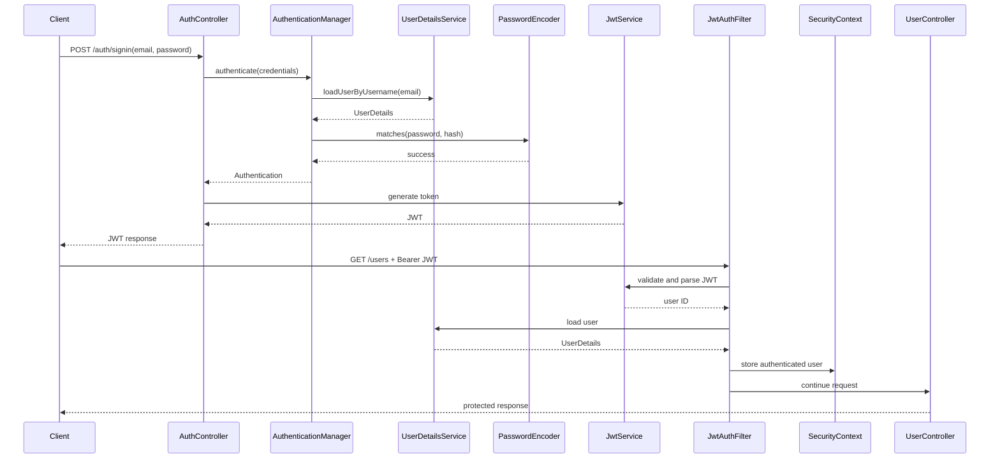

# Spring Security Notes

Project: `learnSpringSecurity`

## 1. Overview

This project implements database-backed authentication using:

- PostgreSQL and JPA for users
- BCrypt for password hashing
- Spring Security for authentication and request authorization
- JWT for stateless authentication
- A custom `OncePerRequestFilter` to validate Bearer tokens

The important distinction is:

```text
Authentication  = Who is the user?
Authorization   = What is the user allowed to do?
```

## 2. Current Request Flow

### Signup

```text
POST /auth/signup
    ↓
Auth controller
    ↓
AuthServ
    ↓
Hash password with BCrypt
    ↓
Save User in PostgreSQL
    ↓
Generate JWT
    ↓
Return user data and token
```

### Signin

```text
POST /auth/signin
    ↓
AuthenticationManager
    ↓
UserDetailsService loads user by email
    ↓
PasswordEncoder compares password and BCrypt hash
    ↓
Authentication object is returned
    ↓
Generate JWT
    ↓
Return user data and token
```

### Protected request

```text
GET /users
Authorization: Bearer <jwt>
    ↓
JwtAuthFilter
    ↓
Extract token from Authorization header
    ↓
Verify JWT signature and expiration
    ↓
Read user ID from subject claim
    ↓
Load user from database
    ↓
Create authenticated Authentication object
    ↓
Store it in SecurityContext
    ↓
Spring Security allows the request
```

## 3. Important Classes

### `WebSecurityConfig`

Defines the security filter chain:

- Disables CSRF for this stateless API learning project.
- Permits `/auth/**` without authentication.
- Requires authentication for all other endpoints.
- Registers `JwtAuthFilter` before Spring’s username/password filter.
- Exposes `AuthenticationManager` as a Spring bean.

```java
.requestMatchers("/auth/**").permitAll()
.anyRequest().authenticated()
```

### `User`

The entity represents both:

- A database user entity
- Spring Security’s `UserDetails`

```java
public class User implements UserDetails
```

The email is used as the username:

```java
@Override
public String getUsername() {
    return email;
}
```

### `UserSer`

Implements `UserDetailsService` and loads a user during authentication:

```java
loadUserByUsername(email)
```

Spring Security uses this service when `AuthenticationManager` authenticates signin credentials.

### `PasswordEncoder`

Passwords must never be stored as plain text.

```java
passwordEncoder.encode(rawPassword)
passwordEncoder.matches(rawPassword, storedHash)
```

BCrypt automatically uses a salt, so the same password normally produces different hashes.

### `AuthenticationManager`

The authentication coordinator. It connects the login request to:

```text
AuthenticationManager
    ↓
AuthenticationProvider
    ↓
UserDetailsService + PasswordEncoder
```

The application should not manually query the user and compare the password when using this flow.

### `JwtService`

Responsible for:

- Creating JWTs
- Signing JWTs with a secret key
- Parsing and validating JWTs
- Reading the user ID from the subject claim

The token contains claims such as:

```json
{
  "sub": "user-id",
  "email": "user@example.com",
  "roles": ["USER", "ADMIN"],
  "iat": "issued-at-time",
  "exp": "expiration-time"
}
```

### `JwtAuthFilter`

Runs once for each request.

It should:

1. Read the `Authorization` header.
2. Check for the `Bearer ` prefix.
3. Extract the token.
4. Validate the signature and expiration.
5. Load the user.
6. Create an authenticated `Authentication` object.
7. Store it in `SecurityContextHolder`.

The three-argument constructor is important:

```java
new UsernamePasswordAuthenticationToken(
        user,
        null,
        user.getAuthorities()
)
```

The two-argument constructor creates an unauthenticated token. That causes `401 Unauthorized` even when the JWT itself is valid.

## 4. `Authentication` and `getPrincipal()`

`Authentication` represents the current security identity for a request.

```java
authentication.getPrincipal()
```

returns the authenticated user. In this project, it can be cast to `User` because `User` implements `UserDetails`.

```java
User user = (User) authentication.getPrincipal();
```

Other useful methods:

```java
authentication.getName();
authentication.getAuthorities();
authentication.isAuthenticated();
```

The authentication is stored for the current request in:

```java
SecurityContextHolder.getContext().getAuthentication()
```

## 5. Authentication vs Authorization

Authentication verifies identity:

```text
Is this really user A?
```

Authorization checks access:

```text
Can user A access this endpoint?
```

Example:

```java
.anyRequest().authenticated()
```

only requires a logged-in user.

Role-based authorization would be more specific:

```java
.requestMatchers("/admin/**").hasRole("ADMIN")
```

The current project returns an empty authority list, so role-based authorization is not implemented yet.

## 6. Why JWT is Stateless

With JWT authentication, the server does not need to store a login session. The client sends the token on every request:

```http
Authorization: Bearer <token>
```

The server validates the token and reconstructs the authentication context for that request.

Advantages:

- Works well for REST APIs.
- No server-side session storage is required.
- Can scale across multiple application instances.

Trade-offs:

- Revoking a token is more difficult.
- A stolen token can be used until expiration.
- Token expiration and refresh-token design are important.

## 7. Security Configuration Notes

### CSRF

CSRF is disabled because this project is using a stateless API with Bearer tokens. For browser applications using cookies and sessions, CSRF protection should normally remain enabled.

### HTTP Basic

`httpBasic()` is useful for learning and testing, but it is a separate authentication mechanism from JWT. A JWT request uses the custom JWT filter; a Basic request uses HTTP Basic authentication.

### Secret key

The JWT secret must:

- Be consistent when generating and validating tokens.
- Be sufficiently long for the selected HMAC algorithm.
- Be stored in an environment variable or secret manager in production.
- Never be committed to Git.

## 8. Common Errors

### `401 Unauthorized` with a valid-looking token

Check:

1. The token is not expired.
2. The signing secret is the same during generation and validation.
3. The header is exactly:

   ```http
   Authorization: Bearer <token>
   ```

4. The filter is registered in the security chain.
5. The filter creates an authenticated three-argument token.
6. The filter sets the authentication in `SecurityContextHolder`.

### `Could not resolve placeholder 'Jwt.key'`

The property name in YAML and `@Value` must match exactly.

```yaml
Jwt:
  key: ${JwtSecretKey:development-secret-at-least-32-characters}
```

```java
@Value("${Jwt.key}")
private String secretKey;
```

### `ExpiredJwtException`

The token’s `exp` claim is in the past. Generate a new token or implement a refresh-token flow.

### Empty authorities

An empty authority list can still pass `.authenticated()`, but it cannot pass `.hasRole("ADMIN")` or `.hasAuthority(...)`.

### Do not use `System.out.println` for authentication data

Avoid logging users or tokens. Even hashed passwords and JWTs are sensitive.

## 9. Current Limitations and Next Improvements

- Add roles to the user model instead of hard-coding roles in the JWT.
- Use `UsernamePasswordAuthenticationToken` with real authorities.
- Handle invalid and expired JWTs with a consistent `401` response.
- Use `POST /auth/signin` instead of sending credentials in a `GET` request body.
- Add request validation with `@Valid`, `@Email`, and `@NotBlank`.
- Use a dedicated DTO or principal object instead of exposing the JPA entity directly.
- Configure stateless sessions explicitly when the application is fully JWT-based.
- Add refresh tokens and token revocation if required.
- Use Flyway or Liquibase instead of `ddl-auto: create` outside early learning.
- Add tests for signup, signin, invalid credentials, expired JWTs, and protected endpoints.

## 10. Sequence Diagram



## 11. Interview Questions and Answers

### What is Spring Security?

Spring Security is a framework for authentication, authorization, security filters, password encoding, session management, and protection against common web security attacks.

### What is `SecurityFilterChain`?

It defines the ordered filters that process incoming HTTP requests and determines which requests are public or protected.

### What is `UserDetails`?

An abstraction representing the authenticated user’s username, password, account status, and authorities.

### What is `UserDetailsService`?

An interface used by Spring Security to load user data during username/password authentication.

### Why use `PasswordEncoder`?

Passwords must be stored as one-way hashes, not plain text. `PasswordEncoder` hashes passwords and safely compares raw passwords with stored hashes.

### What is `AuthenticationManager`?

It coordinates authentication by delegating credentials to an appropriate authentication provider.

### What is `Authentication`?

It represents the result of authentication and contains the principal, credentials, authorities, and authenticated status.

### What is the principal?

The principal is the identity of the current user. In this project, it is the `User` entity returned by `UserDetailsService`.

### Why use a JWT filter?

The filter reads and validates the Bearer token on every request and places the authenticated user into the security context.

### Why must a JWT be signed?

The signature prevents a client from modifying claims such as the user ID or expiration without detection.

### What happens when a JWT expires?

Token validation fails and the request should be rejected with `401 Unauthorized`.

### What is the difference between `401` and `403`?

- `401 Unauthorized`: the request has no valid authentication.
- `403 Forbidden`: the user is authenticated but lacks permission.

### Why does the JWT filter run before `UsernamePasswordAuthenticationFilter`?

The JWT filter must establish authentication before Spring Security authorizes the request.

### Why is `SecurityContextHolder` used?

It stores the authentication for the current request so controllers and authorization rules can access the logged-in user.

## 12. One-Minute Interview Explanation

> I implemented database-backed authentication using Spring Security and JPA. During signup, the password is hashed with BCrypt before being stored. During signin, `AuthenticationManager` uses `UserDetailsService` to load the user and `PasswordEncoder` to verify the password. After successful authentication, the application generates a signed JWT. For protected requests, a custom `OncePerRequestFilter` extracts the Bearer token, validates its signature and expiration, loads the user, creates an authenticated `Authentication` object with the user’s authorities, and stores it in `SecurityContextHolder`. The security filter chain then allows authenticated requests such as `/users`.

## 13. Summary

```text
Signup:
  raw password → BCrypt hash → database

Signin:
  credentials → AuthenticationManager → UserDetailsService → PasswordEncoder → JWT

Protected request:
  Bearer JWT → JwtAuthFilter → validate token → load user → SecurityContext → authorize request
```

The most important lesson is that verifying a JWT is not enough. Spring Security must also receive an authenticated `Authentication` object in the `SecurityContext` before `.authenticated()` endpoints will allow the request.
